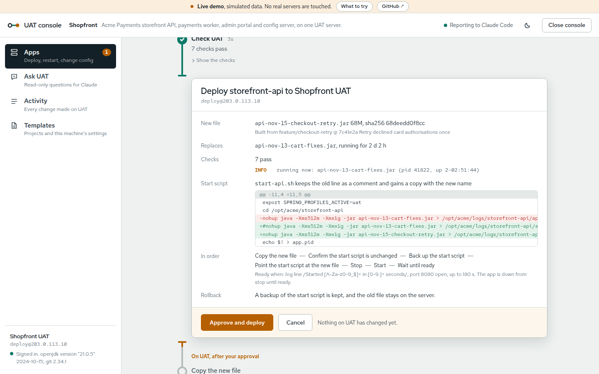
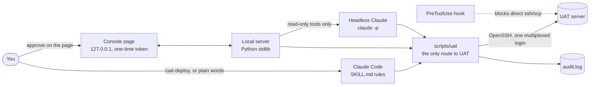
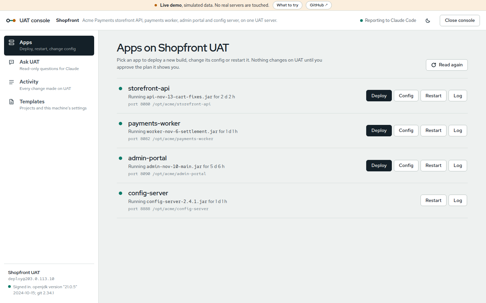
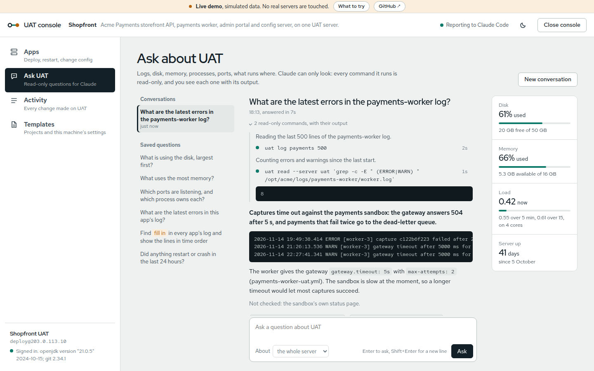
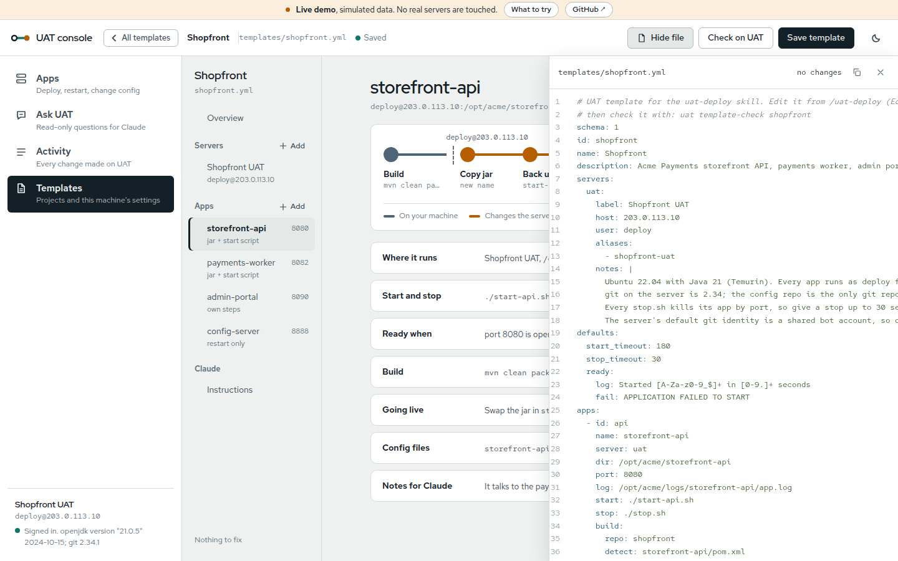

# uat-deploy

A [Claude Code](https://claude.com/claude-code) skill that deploys builds, changes config files and answers questions on a team's UAT servers. Nothing on the server changes until you approve a written plan. You can ask in plain words ("deploy this branch to UAT", "why is the payments worker failing?") or use the browser console that comes with it. Behind it is one guarded shell helper that runs every server command, and every change goes to an audit log.

**[▶ Try the live demo](https://uat-deploy-demo.vercel.app)**: the real console running against a simulated project, entirely in your browser.



## The problem

On a typical Java team, getting a build onto a shared UAT server goes like this: ssh in, copy a jar, edit the start script by hand, restart, tail the log and hope. Config changes are made in vi on the server, and someone forgets to restart the config server first. These are the usual ways it goes wrong:

- the wrong jar ends up running
- the edited line can't be found afterwards
- a config value is overwritten with no trace of what it was
- nobody can say who changed what last Tuesday

AI agents can already type the ssh commands, but on a shared server that's the risky part. **uat-deploy keeps the speed and puts strict checks around every step:** Claude prepares and checks the change, you read exactly what will happen, and only an approved plan runs.

## What it does

| | |
|---|---|
| **Deploy a build** | Builds locally (Maven, Gradle, anything), names the file, runs read-only checks on UAT (folders, scripts, disk, name clash, what runs now), and shows the plan with the exact start-script diff. After you approve, it uploads, switches, restarts and waits until the app is ready. If that fails, it offers a rollback. |
| **Change config** | You describe the change in words. Claude finds the key in a fresh copy of the file and prepares the edit, commenting out the old line rather than deleting it. It then checks the syntax and shows the diff and the changed values. After you approve, it uploads, commits to the server's config repo (or makes a backup), restarts the config server and confirms the new value is served. Restarting the apps that read the file is a separate choice. |
| **Ask about UAT** | Read-only questions about logs, disk, memory, ports and processes. Each command Claude runs is shown with its output, then the answer with its evidence, follow-up questions, and buttons for the next step (open the log, restart, change config). |
| **Templates** | Each project is described by a YAML template (servers, apps, how each is built, started, stopped and checked, config files, notes for Claude), edited in a browser configurator with guided questions. **Detect from server** reads an app's folder and fills in the start script, jar, log and port. |
| **Activity** | The audit log, by day and by app. |

It runs in the terminal by default, or in **UI mode** as a local console page (127.0.0.1 only, one-time token) that covers every flow.

## Safety design

The skill assumes the server is shared and that mistakes are expensive.

- **Nothing changes before an approved, written plan.** Every plan is built and checked first, and the approve button is tied to a digest of that exact plan. If the plan changes, the approval is refused.
- **Read-only first.** The checks before a deploy, the configurator's Detect and Check on UAT, and every Ask question use only allow-listed read commands. The `uat read` helper refuses command substitution, redirection, background jobs and anything that runs other commands.
- **Nothing is deleted.** The helper blocks `rm`, `sudo`, `kill`, overwriting `mv`/`cp`, `>` truncation and destructive git. Uploads must have a new name, so a file is never overwritten. Start scripts get a timestamped `.bak-` copy before they're edited. In config edits the old line is commented out and kept, and the file is committed or backed up.
- **One route to the server.** A Claude Code `PreToolUse` hook, declared in the skill itself, blocks direct `ssh`/`scp` to any server a template names, and any read of a password file. Everything goes through `scripts/uat`, which writes each change to an audit log (time, user, app, command, exit status).
- **Headless Claude gets a narrow toolset.** For questions, the console runs `claude -p` with only the helper's read-only commands allowed. For a config edit, it can only search and check YAML, diff, and edit the one local copy. It can't change anything on UAT, and it returns structured JSON (`--json-schema`), not free text.
- **Stop at the first failure.** A failed deploy shows what is now true on UAT, offers **Roll back** or **Leave as is**, and has **Ask Claude why**. It never retries or guesses.
- **UAT only.** Servers whose id or name says prod, production or live are refused. Templates hold no secrets; the configurator won't save anything that looks like one.

## How it works



1. **Templates** (`templates/<id>.yml`) describe each project, and the configurator writes them in a fixed format that reviews well in git. Settings for one machine only (local repo folders, git identity, sign-in) live in `~/.config/uat-deploy/`, never in a template.
2. **`scripts/uat`** (Bash) is the only command that talks to a server. It uses one SSH ControlMaster connection per server, so there's one login per session, with a password sent once through `SSH_ASKPASS` if you use one. It has `--dry-run` for every change.
3. **The console** (`scripts/uat-console` with `ui/console.html`) runs each operation as a line of stations: on your machine, then read-only on UAT, then the approval gate, then changes on UAT. Progress is long-polled so output streams live. While Claude Code is following the page (`uat console --wait`), it reports each finished operation in the conversation.
4. **Ask and config edits** start headless Claude Code with a prompt from `prompts/` and only the tools that step needs.

## Screenshots

| | |
|---|---|
|  |  |
| **Apps**: what runs on each app now, with Deploy, Config, Restart and Log. | **Ask UAT**: every read-only command with its output, then the answer with evidence. |
|  |  |
| **Deploy**: the plan waits at the gate, with the exact start-script diff. | **Configurator**: one app's route from build to ready, and the YAML that will be saved. |

## Install and use

```sh
git clone https://github.com/renjithroy/uat-deploy ~/.claude/skills/uat-deploy
chmod +x ~/.claude/skills/uat-deploy/scripts/*
pip install --user pyyaml
```

Keep it at exactly `~/.claude/skills/uat-deploy`: the safety hook is registered at that path. Installed anywhere else, the skill still works, but the hook is skipped. You'll also need OpenSSH 8.4 or later, Python 3, a browser for the configurator, and whatever your templates' build commands need (Maven, Gradle, a JDK).

In Claude Code:

```text
/uat-deploy                          menu: deploy, config, ask, templates
/uat-deploy shopfront deploy api     deploy one app of one project
/uat-deploy ask                      read-only questions
/uat-deploy mode ui                  use the browser console by default
/uat-deploy templates                create or edit a project template
```

The first run asks which project you work on, where your local clone of each repo is, the git identity for config commits, and how to sign in to each server. `templates/shopfront.yml` is a complete example (a fictional Acme Payments project) to start from.

## Tech

- **Claude Code skill**: `SKILL.md` with `allowed-tools`, a skill-scoped `PreToolUse` hook, and rules the agent follows in every flow. Headless `claude -p` runs with `--allowedTools`, `--json-schema` and `--output-format stream-json`.
- **Python 3 standard library** for the console and configurator servers (`http.server`, threads, long polling), plus PyYAML for templates and config diffs.
- **Bash and OpenSSH** for the helper: ControlMaster multiplexing, `SSH_ASKPASS`, allow-listed read commands, checksums on every upload.
- **Vanilla HTML, CSS and JavaScript** for both pages: no framework and no build step, with light and dark themes, and they work at phone width.
- **Demo**: an in-browser stand-in for the two servers, a dependency-free Node build, and static hosting on Vercel.

## About the demo

The [live demo](https://uat-deploy-demo.vercel.app) serves the real `ui/console.html` and `ui/index.html`, unchanged. A script in `demo/mock-api.js` answers their `/api/*` calls in the browser with the same response shapes as the Python servers. Behind it is a made-up project: Acme Payments' Shopfront, with four Spring Boot apps on `203.0.113.10`, a documentation-only IP. Deploys stream a Maven build and stop at the approval gate. Config changes produce real diffs from a small parser. Ask UAT plays back recorded investigations, and the configurator previews YAML byte-for-byte as the Python renderer would. Nothing leaves your browser, and the state lasts for the tab. **Tip:** put `broken` in a build's name to see a failed start, the rollback, and **Ask Claude why**.

Build and run it locally:

```sh
node demo/build.mjs                         # writes dist/
python3 -m http.server -d dist 8000         # open http://localhost:8000
python3 demo/make-fixtures.py               # after changing templates/shopfront.yml
```

## Reference

### Menu

Type `/uat-deploy` in Claude Code, optionally followed by a template id, `deploy`, `config`, `ask` or `templates`, and an app id (`/uat-deploy shopfront deploy api`). Claude can also start the skill itself when you ask for UAT work in plain words ("deploy this to Shopfront UAT", "what is running on UAT?"). It never starts on its own after a code change, and every change on UAT still waits for your approval of the plan.

| Menu | What happens |
|---|---|
| Deploy an app | Shows what runs now and asks for the new file name. It builds, renames the built file, runs a read-only checklist and shows the plan. After approval, it uploads the file and switches to it (with a start-script edit or the template's custom steps), restarts, and waits until the app is ready. On failure it offers a rollback. |
| Update config | Finds the key in the server copy and proposes the edit, with old lines commented out, never deleted. It checks the syntax and shows the diff. After approval, it uploads, commits (or makes a backup), restarts the serving app and checks the new value is served. Restarting the apps that read it is a separate approval. |
| Ask about UAT | Read-only investigation: logs, memory, disk, nginx, processes. Any change it suggests needs approval. |
| Templates | Switch project, edit or create a template in the configurator, or change this machine's settings. |

### UI mode

`/uat-deploy mode ui` makes the console page the default on this machine; `/uat-deploy mode terminal` switches back (the default). `/uat-deploy ui` opens the console once, whatever the mode. From a terminal: `uat mode [ui|terminal]` and `uat console [APP] [--view apps|config|ask|activity|templates]`.

| Section | What it does |
|---|---|
| Apps | Every app with what runs now, and Deploy, Config, Restart and Log for each. Inside an app, a tab strip switches between apps. |
| Deploy tab | A deploy drawn as a line of stations: name the new file, build (live output), rename, check UAT, then a gate that holds the written plan. Nothing on UAT changes before **Approve and deploy**; after it, each step runs live. A failed deploy shows what is now true on UAT and offers Roll back or Leave as is. |
| Config tab | Describe the change in words. Claude finds the key in a fresh copy of the file and prepares the edit (old lines commented out, never deleted), asking when something is unclear. The gate shows the diff, the changed values and the plan. After **Approve and upload**, it uploads, commits or makes a backup, restarts the serving app and checks the served values. It then offers Restart now / Not now for the apps that read the file. A change can be reverted from the page. |
| Ask UAT | A strip showing the server's disk, memory, load and uptime, read live. You ask read-only questions in your own words, and each command Claude runs is shown with its output as it works. Then come the answer with its evidence, suggested follow-up questions, and buttons that open the matching log, restart plan, deploy or config change. Conversations are kept and can be reopened. Questions can be saved and asked again with one click, with a blank to fill in where needed. |
| Activity | The audit log, by day and by app. |
| Templates | Switch, edit and create templates (the configurator opens inside the console and leads back to it), and this machine's settings: repo folders, build commands, config folder, git identity, sign-in, mode. |

Questions and config edits are prepared by headless Claude Code (`claude -p`), which the console starts with only these tools allowed:

- for questions, the helper's read-only commands
- for a config edit, `yaml-find`, `yaml-check`, `config-diff` and editing the one local copy

It can change nothing on UAT. `UAT_DEPLOY_MODEL` (default `sonnet`) and `UAT_DEPLOY_BUDGET_USD` (default 2, per question or edit) apply when the console starts.

### Templates and the configurator

`uat configure [ID | --new]` opens a local page (127.0.0.1 only, one-time token). A new template, and every app added later, is set up by guided questions, one per screen:

1. the server and how to sign in
2. the app's folder
3. how it starts and stops
4. how it's built (Maven, Maven module, Gradle, other, or not built here)
5. how a new version goes live
6. its config files and notes

After you give the folder, the skill reads it on the server and fills in what it finds. **Check on UAT** verifies every folder, script and config file the template names. **Show file** displays the exact YAML that will be saved, with changed lines marked. A template with problems can't be saved.

### Deploy styles

| Style | What a deploy does |
|---|---|
| `jar-start-script` | Copies the new jar beside the old one, backs up the start script, points its `java -jar` line at the new jar (`duplicate`: comment the old line and add a copy; `replace`: swap the name in place), restarts. Rollback restores the script. |
| `custom` | Uploads the new file under a new name, then runs the template's steps in the app folder (placeholders `{new}`, `{dir}`, `{upload_dir}`, `{stamp}`), restarts. Rollback runs the template's rollback steps. |
| `none` | Restart only: the app isn't deployed, but can be restarted and its config changed. |

### Template fields

```yaml
schema: 1
id: ledger                           # = file name
name: Ledger
description: ...
servers:
  uat:                               # server id, used by apps
    label: Ledger UAT
    host: 203.0.113.25
    user: appuser
    aliases: [ledger-uat]            # Host names in ~/.ssh/config, for the safety hook
    notes: |                         # what Claude should know about this machine
defaults:                            # used by every app that does not set its own
  start_timeout: 180
  stop_timeout: 30
  ready: {log: <pattern>, fail: <pattern>, url: <health URL>}
apps:
  - id: web
    name: ledger-web
    server: uat
    dir: /opt/ledger/web             # commands run here
    port: 8080                       # or process: <text in its command line>
    log: /opt/ledger/logs/web.log
    start: ./start.sh                # or the command you would type
    stop: ./stop.sh
    ready: {log: ..., fail: ..., url: ...}
    build:
      repo: web                      # apps built from one repo share the name
      detect: pom.xml                # marks the right local folder
      command: mvn clean package -DskipTests
      output: target/*.jar
    deploy:
      style: jar-start-script        # or custom, or none
      edit: duplicate                # jar-start-script: duplicate or replace
      start_script: start.sh         # default: the start command's script
      name_prefix: web
      upload_dir: /opt/ledger/web    # custom only
      steps: [ln -sfn {new} current.jar]
      rollback: [ln -sfn previous.jar current.jar]
    configs:
      - id: main
        path: /opt/ledger/config/web.yml
        format: yaml                 # yaml, properties, json, xml, text
        git_repo: /opt/ledger/config # committed there; without it, backed up before each change
        served_by: config            # the app that serves it, if any
        verify_url: http://localhost:8888/web.yml
        restart: [config, web]       # in order, after a change
    instructions: |
instructions: |
```

`uat template-check ID` validates a template from the command line.

### Helper safety rules

- `uat read` runs only allow-listed read-only commands. `uat write` blocks `rm`, `sudo`, `kill`, `chmod`, overwriting `mv`/`cp`, `>` truncation and destructive git commands. Template commands (start, stop, steps) may use `kill`, `nohup`, `&` and `>` the way start and stop scripts do, but never `rm`, `sudo`, destructive git or system changes.
- A password is sent once per login, from a mode-600 file through `SSH_ASKPASS`, and is never retried, so a wrong password can't lock the account. Passwords are masked in all helper output.
- `uat --dry-run <command>` prints the changes a command would make without making them.

### Files

| Path | Contents |
|---|---|
| `SKILL.md` | The skill: rules, flows, allowed tools and the safety hook |
| `scripts/uat` | The helper, the only route to UAT |
| `scripts/uatlib.py`, `scripts/uattpl.py` | Command checks, config diffs and the hook; template loading, validation and rendering |
| `ui/console.html`, `scripts/uat-console` | The UI mode console page and its local server |
| `ui/index.html`, `scripts/uat-ui` | The configurator page and its local server |
| `prompts/` | Instructions for the headless Claude that answers questions and prepares config edits |
| `templates/<id>.yml` | One per project, shared in git |
| `demo/` | The live demo: in-browser mock of the servers, build script, fixtures |
| `~/.config/uat-deploy/local.yml` | This machine only: mode, chosen template, local repo folders, build overrides, git identity, sign-in per server |
| `~/.local/state/uat-deploy/audit.log` | Every change made on UAT: time, user, template/app, command, exit status |
| `~/.cache/uat-deploy/` | Downloaded copies, deploy and config state, the configurator session |

## License

[MIT](LICENSE)
